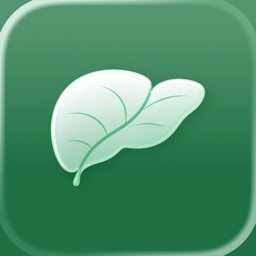
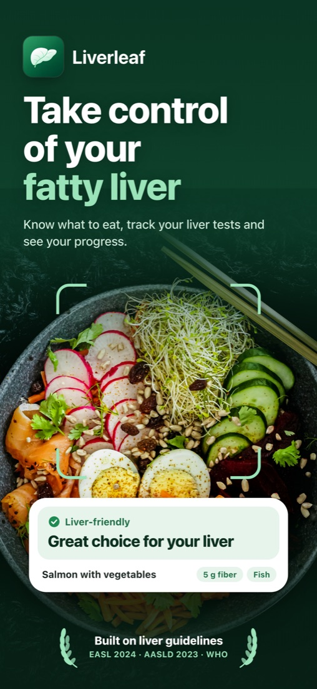
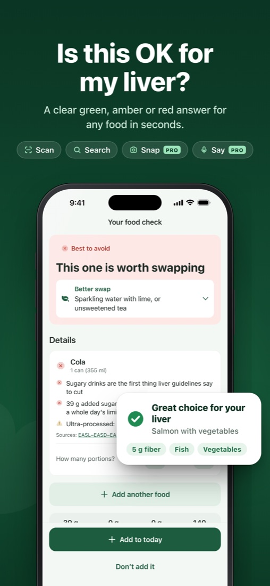
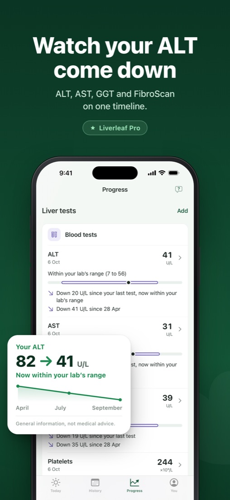
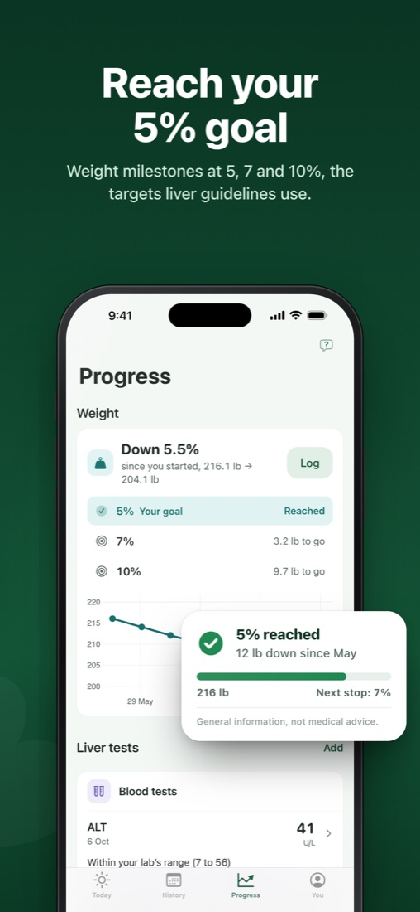
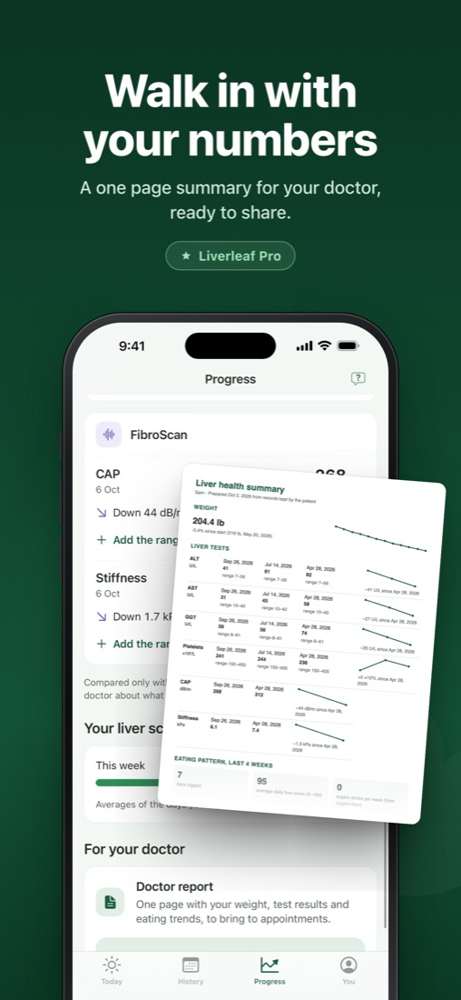

# Liverleaf: fatty liver diet app for iPhone

Liverleaf is an iPhone app for people with fatty liver: check a food with a green, amber or red answer, keep your liver tests and weight in one place, and bring a one-page report to your doctor.

[Download on the App Store](https://apps.apple.com/app/apple-store/id6818028733?pt=128676461&ct=github-readme&mt=8) · [Website](https://health.dailyappslab.com/liver-tracker/)

| | | |
|---|---|---|
|  |  |  |

## What it does

Liverleaf is for adults with fatty liver (NAFLD, now also called MASLD) who want simple daily habits based on published liver guidelines.

Scan a barcode or search a common food and get a green, amber or red answer, with the reason in plain words and a better swap. With Pro you can also snap a photo of your meal, type it or say it. The verdict comes from fixed rules based on the EASL-EASD-EASO 2024 and AASLD 2023 guidelines and WHO guidance. The AI only names the food and estimates its nutrients.

Your meals, coffee, alcohol-free days and walking minutes add up to one daily liver score, with a forgiving streak. You can log liver test results (ALT, AST, GGT, platelets, FibroScan) next to the range printed on your own lab report, and set a weight goal with the 5%, 7% and 10% milestones that liver guidelines use. If you have diabetes or use insulin, you can add that for tips that fit. Pro adds test trends and a one-page doctor report.

There is no account and no sign-up. Your test results and weight stay on your phone.

| | |
|---|---|
|  |  |

## Price

Free to download. Liverleaf Pro is an optional subscription: in the US, $9.99 a month or $39.99 a year, and the yearly plan has a one-week free trial. Prices vary by country. iPhone only for now.

## Read more

- [Liverleaf and fatty liver guides](https://health.dailyappslab.com/liver-tracker/)
- [Privacy policy](https://javediqbal8381.github.io/liverleaf/privacy/)

## Medical note

Liverleaf gives general information, not medical advice. It does not diagnose, treat or interpret your test results. Always follow your doctor.

The app's source code is private. This repository holds the app's public page and screenshots. Questions are welcome as [issues](https://github.com/dailyappslab/liverleaf/issues).

Made by [Javed Iqbal](https://github.com/javediqbal-byte) at [Daily Apps Lab](https://dailyappslab.com/).
